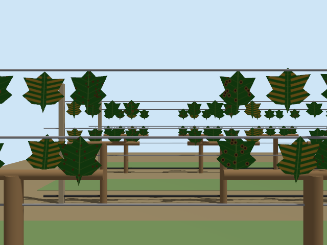

# Vineyard disease simulation

A CPU-first grape-leaf screening prototype with a procedural Gazebo vineyard and ROS 2 camera integration. It is a research/integration fixture, not a validated diagnosis or treatment system.

## Included

- Seeded vineyard generator: rows, trunks, cordons, trellis posts/wires, drip lines/emitters and individual textured leaf meshes.
- Gazebo Harmonic RGB and instance-segmentation cameras; wide and single-leaf close-up views.
- ROS Jazzy bridge and a headless, event-driven camera capture smoke test.
- PlantVillage grape data preparation with source provenance, source splits and grouping metadata.
- CPU MobileNetV2 cropped-leaf inference, conservative score handling and per-class evaluation.
- Optional ROS image observer; no field actuator or spraying interface.
- Unit tests and inactive CI workflow templates; data, weights, generated textures and caches stay local.

## Quick start: simulation



Linux x86-64 and Docker are the tested target. No host ROS installation is needed.

```bash
git clone --branch feat/vineyard-pipeline https://github.com/jayforson/vineyard-disease-sim.git
cd vineyard-disease-sim
make build
make world
make smoke
```

The implementation is on `feat/vineyard-pipeline` pending review. After it is merged, omit `--branch feat/vineyard-pipeline` from the clone command.

The camera capture and logs are written to `runs/sim-smoke/`. The fixture is static: it does not claim autonomous robot navigation. The helper container is resource-limited, has no host networking/devices, and runs as your user.

For a close-up single-leaf fixture:

```bash
bash scripts/run-container.sh python simulation/generate_world.py --view leaf
make smoke
```

Generated worlds and assets stay together under `simulation/generated/`. For custom native Gazebo commands, set `GZ_SIM_RESOURCE_PATH` to that directory. Software rendering is requested; classifier CPU support does not guarantee that every graphics driver can render Gazebo scenes.

## Python pipeline

Inspect the command contracts with:

```bash
bash scripts/run-container.sh python -m vineyard_disease --help
bash scripts/run-container.sh python -m vineyard_disease prepare --help
bash scripts/run-container.sh python -m vineyard_disease predict --help
bash scripts/run-container.sh python -m vineyard_disease evaluate --help
bash scripts/run-container.sh python -m vineyard_disease ros2-observe --help
```

The model is https://huggingface.co/linkanjarad/mobilenet_v2_1.0_224-plant-disease-identification . Its supported grape classes are healthy, black rot, Esca and Isariopsis leaf spot. It does **not** include grape powdery mildew or downy mildew. Model scores are uncalibrated and cannot rule out unsupported diseases.

Prepare a bounded sample and evaluate the existing checkpoint (no new training):

```bash
bash scripts/run-container.sh python -m vineyard_disease prepare --max-per-class 12 --seed 0
bash scripts/run-container.sh python -m vineyard_disease predict \
  --manifest data/plantvillage_grape_color/manifest.jsonl --split test \
  --num-threads 2 --output runs/plantvillage-predictions.jsonl
bash scripts/run-container.sh python -m vineyard_disease evaluate \
  --manifest data/plantvillage_grape_color/manifest.jsonl --split test \
  --predictions runs/plantvillage-predictions.jsonl --output-dir runs/evaluation
```

The default source and model revisions are pinned. The sample above selects 12 images per class per source split (96 total when all classes are available). Data acquisition uses bounded range reads, not execution of a remote dataset loading script, and sends no authentication token. Network failures do not produce synthetic replacement data. Local class-directory input is also supported; inspect `prepare --help`.

Run the live Gazebo-camera → ROS observer → CPU model integration:

```bash
bash scripts/run-container.sh python simulation/generate_world.py \
  --manifest data/plantvillage_grape_color/manifest.jsonl --source-split train \
  --view leaf --rows 1 --vines 2 --output simulation/generated-real
bash scripts/run-container.sh python scripts/sim_smoke.py \
  --world simulation/generated-real/vineyard.sdf --output runs/end-to-end \
  --observe --timeout 120
```

The observer uses the explicitly configured center crop in `simulation/closeup-roi.json`, **not a learned leaf detector**. It publishes JSON observations on `/vineyard/leaf_observations`; `runs/end-to-end/` contains the image, logs and result. Add `--local-files-only` after the model has been cached to ensure offline inference. Rendered photo textures retain source attribution/license metadata and are not included in Git.

For Python-only development, install the project in a local virtual environment. Install CPU PyTorch from the CPU wheel index before the remaining ML extras if you do not want CUDA packages.

```bash
python3 -m venv .venv
source .venv/bin/activate
python -m pip install torch==2.7.1 --index-url https://download.pytorch.org/whl/cpu
python -m pip install -e '.[ml,dev]'
python -m vineyard_disease --help
python -m pytest -q
```

## Real photos versus simulation

Use real, expert-labeled images for disease learning and independent field evaluation. Default rendered symptom patterns are stylized fixtures, not clinical examples. Prepared image manifests can be supplied to the world generator with `--manifest`; missing classes remain explicitly marked synthetic in the scene metadata.

The prototype accepts a single-leaf image or an explicitly chosen crop. It does not include a trained leaf detector for wide vineyard frames. Gazebo ground-truth labels stay separate from inference inputs; object masks are not lesion masks.

## Tests

```bash
make test
# Lightweight tests without ROS/Gazebo/ML weights:
python -m pip install -e '.[dev]'
python -m pytest -q
```

Inactive workflow templates are in `docs/ci/templates/`; GitHub Actions is not enabled by this prototype. See [CI activation](docs/ci/README.md) for the separate workflow-scope authorization and activation steps. The heavier simulation template is manual-only. None of these checks is a field-accuracy benchmark.

See [architecture](docs/ARCHITECTURE.md) and [data/model boundaries](docs/DATA_MODEL_NOTES.md) for provenance, missing classes, evaluation rules and planned extensions. Original code is MIT-licensed; third-party data and model terms are separate. No internal project documents, real vineyard coordinates, credentials, model weights or downloaded images are included.
